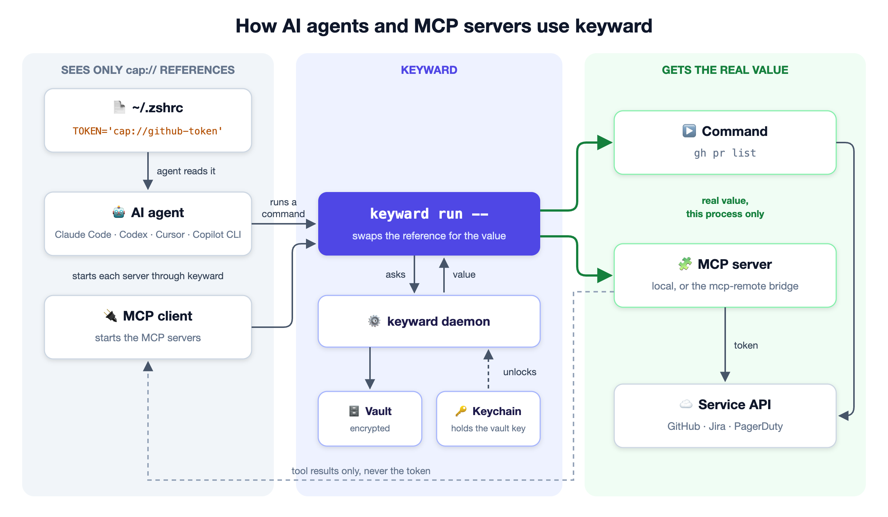

# keyward

**Your dotfiles are safe from the internet, not from your AI agents.**

Keyward moves the tokens in `~/.zshrc`, `.env` and similar files into an
encrypted vault, keyed by the macOS Keychain, and leaves a reference behind:

```sh
export API_TOKEN='cap://api-token'
```

Agents reading your files see only the reference. `keyward run` gives the real
value to the one command that needs it. It guards against accidental exposure,
not deliberate theft; see [What it protects](#what-it-protects).



## Install

```sh
brew tap veilux-lab/keyward https://github.com/veilux-lab/keyward.git   # needed first
brew install veilux-lab/keyward/keyward
keyward setup                                                            # then this, in Terminal.app
```

`keyward setup` moves the secrets out of your shell files and the current folder's
`.env`, points your AI agents at keyward's instructions, runs your MCP servers
through keyward, and shows your recovery code. It asks before each step.

Apple Silicon only. On Intel, [build it from source](docs/details.md#building-from-source).

## Use

```sh
keyward migrate --dry-run ~/.zshrc        # preview; hides values and token-like comments
keyward migrate ~/.zshrc                  # move a file's secrets; asks for "yes"
keyward run --only API_TOKEN -- npm test  # run a command with the values it names
keyward ls                                # stored names
keyward doctor                            # check your setup
keyward help                              # commands and options
```

- Start anything that needs a secret through `keyward run`; anything else sees
  only the `cap://` reference. Name the variables a command needs with `--only`;
  without it, `keyward run` resolves every reference in its environment. Don't
  start your editor that way, or everything inside it gets the values.
- Any process can read a program's command line, and security tools log it. So
  `keyward run` refuses a `sh -c` script that would put a value in another
  program's arguments, as `curl -H "Authorization: Bearer $API_TOKEN" URL` would.
  It names the variable, the program and the line, and shows the safe form, here
  `printf 'header = "Authorization: Bearer %s"\n' "$API_TOKEN" | curl -K - ...`.
  `printf` is built into the shell, so it has no command line of its own.
  `--allow-command-line` runs the script anyway.
- When a command's output goes to an agent, a pipe or a file rather than a
  terminal, `keyward run` shows `cap://name#masked` in place of each value it gave
  the command, also when JSON-, URL- or base64-encoded, and says so. A program
  that runs `keyward run` to read a value, such as a credential helper like git's
  `credential.helper` or Claude Code's `apiKeyHelper`, gets the placeholder
  instead, so such a command needs `--no-mask`. Masking has
  [limits](docs/details.md#masking).
- `keyward doctor` also finds tokens still in plaintext in your shell files, the
  current folder's `.env`, and MCP configs, and says where each one is and what it
  looks like, such as "a GitHub token", without printing it. Nearby lines of one
  kind are listed as one range. Name another file to check it too:
  `keyward doctor .env.local`. If a line it lists in a shell or `.env` file holds
  no secret, end it with `# keyward:ignore`, marking each line of a range of
  values that may be credentials, and keyward leaves the line alone.
- Migration keeps an encrypted backup. Remove it with `keyward backups rm ~/.zshrc`
  once everything works.

## MCP servers

MCP servers that use a migrated token must start through keyward too.
`keyward mcp` covers Claude Code, Codex and Cursor.

```sh
keyward mcp          # list each server that needs a change, with the fix
keyward mcp wrap     # make the changes for Claude Code, after a "yes"
keyward mcp unwrap   # start them without keyward again
```

For Codex and Cursor, make the edits `keyward mcp` prints. It cannot see a server
that reads a variable its config does not name; wrap that one by hand.
`keyward run` refuses to start a server that would put a token in a command line,
in its URL or as an argument, and `keyward mcp` says how to fix it. After
upgrading keyward, run `keyward mcp` again.
[More on MCP servers](docs/details.md#mcp-servers).

## Save your recovery code

The vault key exists only in your Keychain; if it is lost, so are your secrets.
`keyward setup` and `keyward recovery show` print your recovery code. Run them in
Terminal.app, not an editor's terminal, which AI agents can read, and keep the
code in a password manager. `keyward recovery restore` brings the key back.

## Moving to a new Mac

The vault file and its key in the Keychain must both reach the new Mac. Migration
Assistant usually copies both; other tools often copy only the files, and then you
need the recovery code. [How to move](docs/details.md#moving-to-a-new-mac).

## Uninstall

```sh
keyward uninstall --dry-run   # the full plan; changes nothing
keyward uninstall             # undo everything, after one "yes"; secrets stay in the vault
keyward uninstall --purge     # the same, and delete the vault and its key
```

Use `keyward uninstall`, not `brew uninstall`, which removes only the program. To
put one file back without uninstalling: `keyward restore ~/.zshrc`.
[What uninstall does](docs/details.md#uninstall).

## What it protects

Keyward prevents accidental exposure, not deliberate theft: any process running as
you can ask for a value. It makes no network connections and logs names, never
values. Masking and the command-line check guard against mistakes, not against
someone working around them on purpose; see the limits of
[masking](docs/details.md#masking) and of
[the command-line check](docs/details.md#the-command-line-check).

Report vulnerabilities privately ([SECURITY.md](SECURITY.md)). MIT licensed
([LICENSE](LICENSE)).
