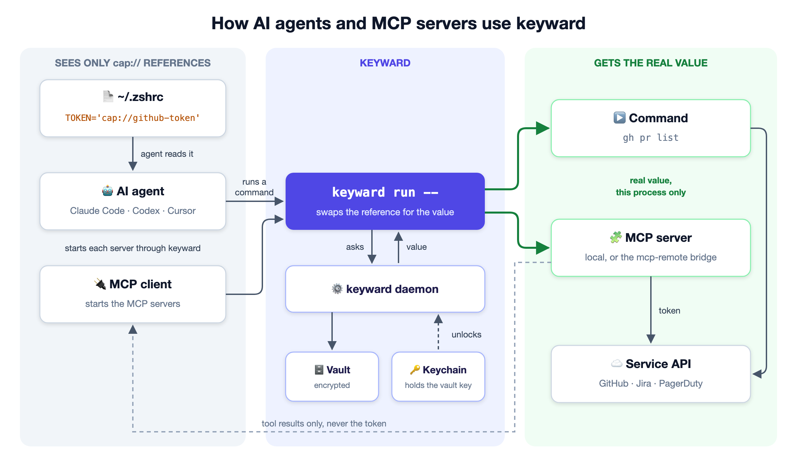

# keyward

**Your dotfiles are safe from the internet, not from your AI agents.**

Keyward moves the tokens in `~/.zshrc`, `.env` and similar files into an
encrypted vault, keyed by the macOS Keychain, and leaves a reference behind:

```sh
export API_TOKEN='cap://api-token'
```

Agents reading your files see only the reference. `keyward run` gives the real
value to the one command that needs it.



## Install

```sh
brew tap veilux-lab/keyward https://github.com/veilux-lab/keyward.git   # needed first
brew install veilux-lab/keyward/keyward
```

Apple Silicon only. On Intel, build it with Go: `go build -o keyward ./cmd/keyward`,
then run `./keyward daemon`. To start it at login instead, sign it with a free Apple
Development certificate: `make install SIGN_IDENTITY='Apple Development: …'`.

## Use

```sh
keyward migrate --dry-run ~/.zshrc   # preview; values are never printed
keyward migrate ~/.zshrc             # move the secrets; asks for "yes"
keyward run -- npm test              # run a command with the real values
keyward ls                           # stored names
keyward doctor                       # check your setup
```

- Start anything that needs a secret through `keyward run --`; otherwise it sees
  the `cap://` reference. Don't start your editor that way, or everything inside
  it gets the values.
- Migration keeps an encrypted backup. Remove it with `keyward backups rm ~/.zshrc`
  once everything works.
- Keyward writes `~/.agents/keyward.md`, instructions for AI agents; `keyward agents`
  shows how to point your agents at it.
- `keyward help` lists every command.

## Save your recovery code

The vault key exists only in your Keychain; if it is lost, so are your secrets.
Run `keyward recovery show` once in a terminal and keep the code in a password
manager. `keyward recovery restore` brings the key back.

## MCP servers

MCP servers that use a migrated token must start through keyward too. `keyward mcp`
prints the fixed definition for each affected server in Claude Code, Codex and
Cursor, without editing anything. A server that reads a variable without naming it
in its config can't be detected; wrap it by hand the same way.

## Restore or uninstall

```sh
keyward restore ~/.zshrc      # put the values back; asks for "yes"
keyward uninstall             # remove keyward; secrets stay in the vault
keyward uninstall --purge     # also delete the vault, once no file uses it
```

## What it protects

Keyward prevents accidental exposure, not deliberate theft: any process running as
you can ask for a value. It makes no network connections and logs names, never
values.

Report vulnerabilities privately ([SECURITY.md](SECURITY.md)). MIT licensed
([LICENSE](LICENSE)).
